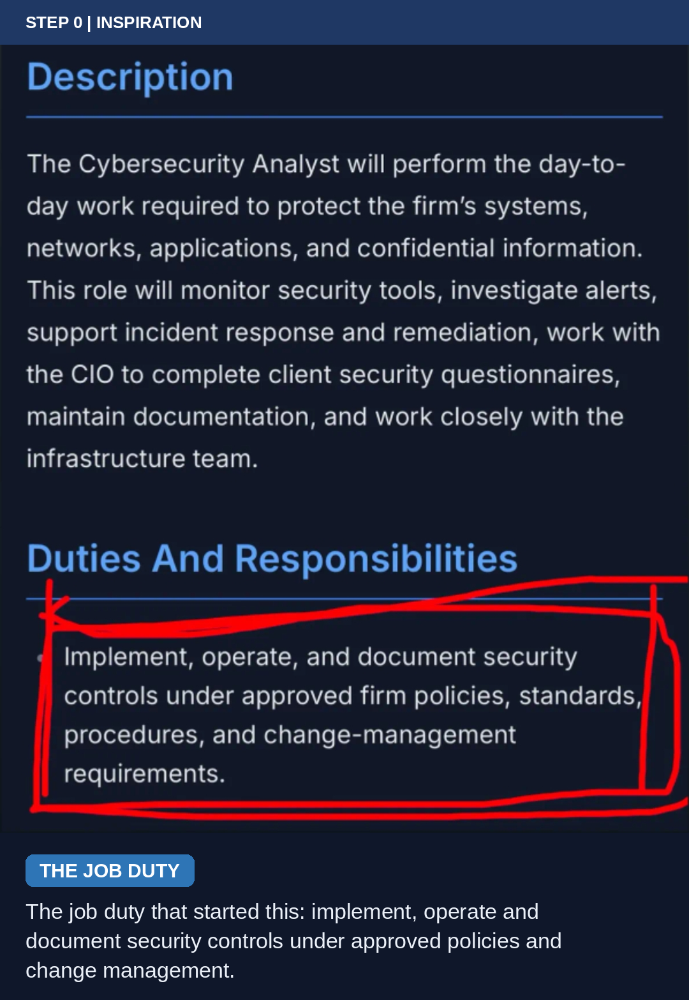
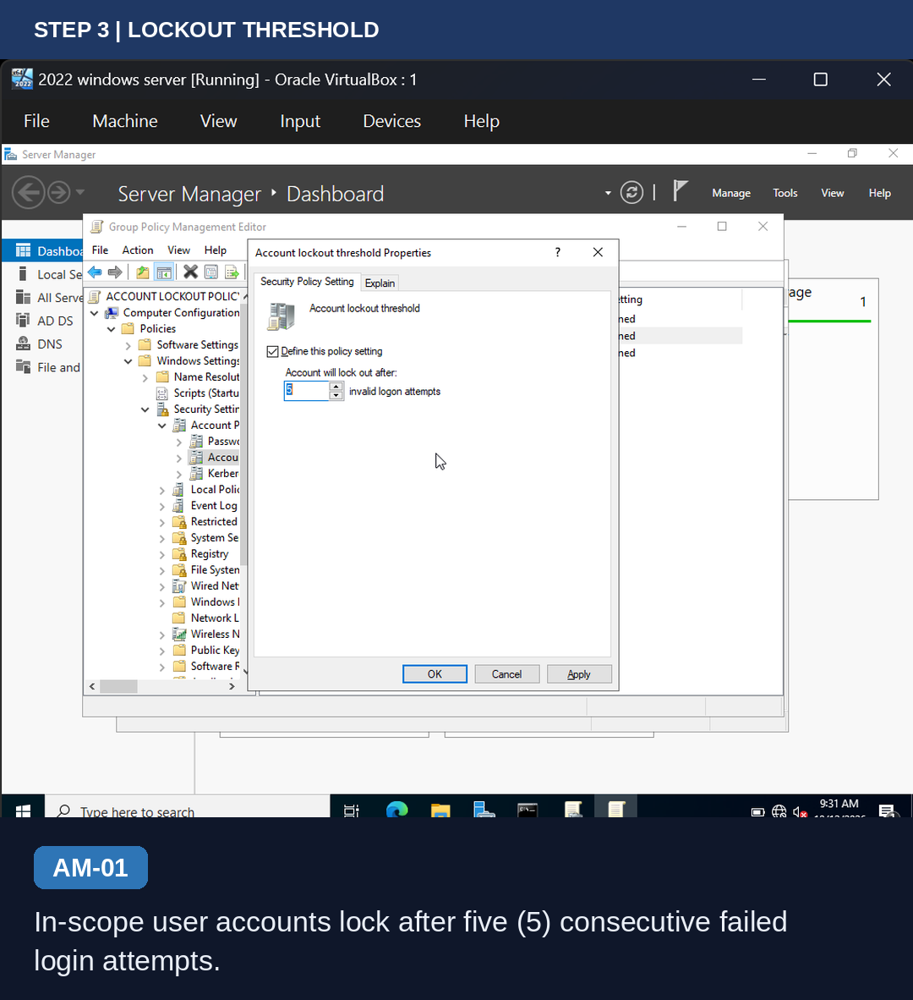
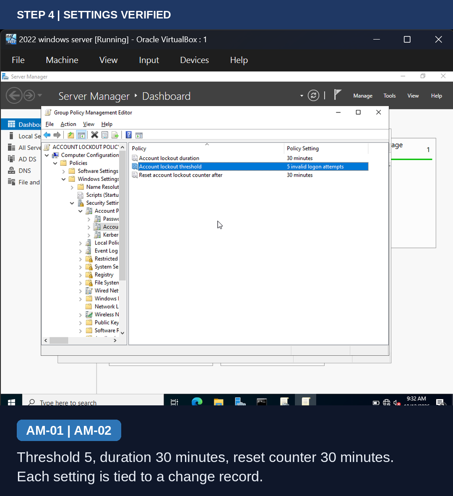
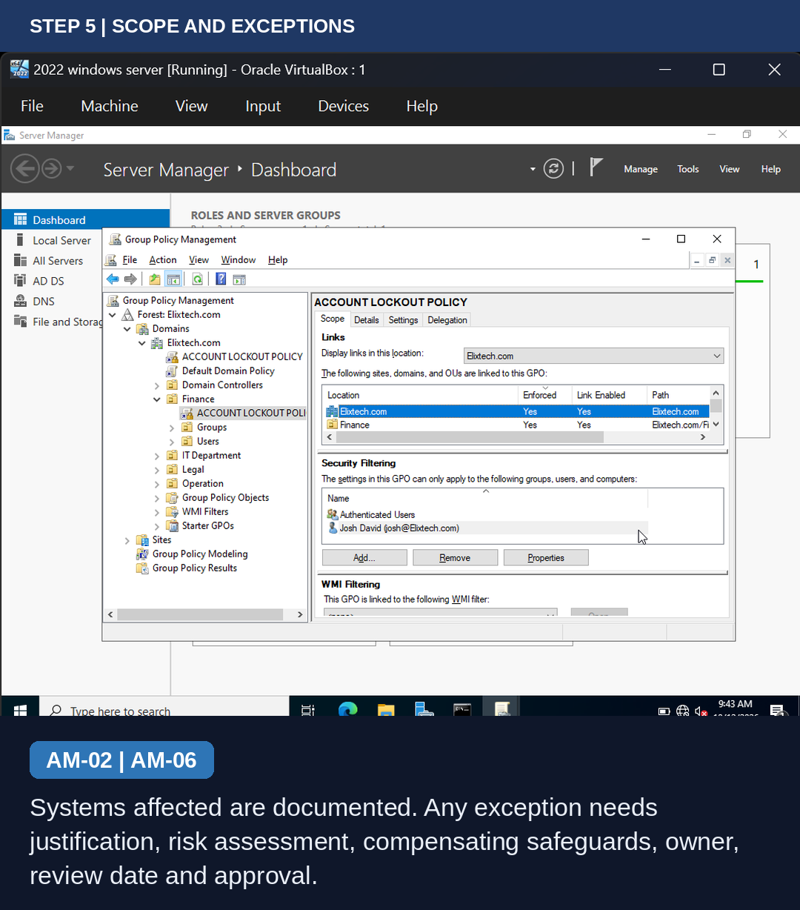
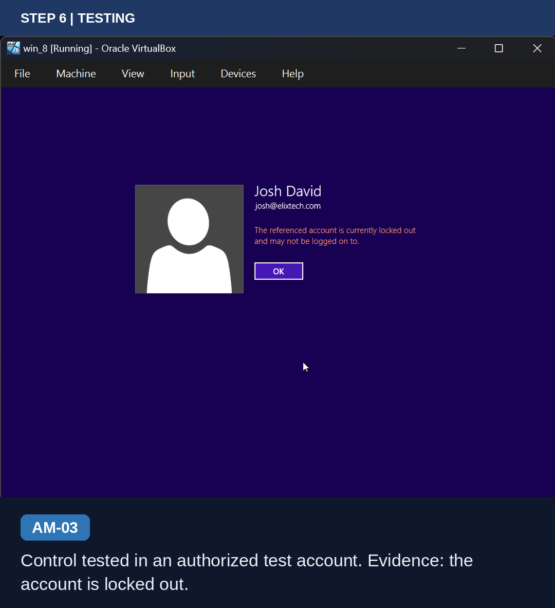

# IMPLEMENTING-AN-ACCOUNT-LOCKOUT-CONTROL
# Implementing Account Lockout Controls in Active Directory

**Policy-driven, change-managed and tested.** A hands-on cybersecurity lab where an account lockout control is written as policy, logged as a change, implemented with Group Policy, tested, and documented with evidence.

| | |
|---|---|
| **Domain** | Elixtech.com |
| **Date** | 12 October 2026 |
| **Role focus** | Cybersecurity Analyst (Junior) |
| **Policy** | Access Management Policy (AM-01 to AM-06) |
| **Standard** | ISO 27001:2022 Annex A 5.15, 5.17, 8.5, 8.32 |
| **Environment** | Windows Server 2022 domain controller, Windows 8 client, Oracle VirtualBox |

---

## Why This Project

I came across a **Cybersecurity Analyst** job description online (a junior, full-time role at a law practice). Most of the listing covered monitoring, alerts and incident response, but one duty stood out to me:

> *"Implement, operate, and document security controls under approved firm policies, standards, procedures, and change-management requirements."*


*Figure 0: The job duty that inspired this project: implement, operate and document security controls under approved policies and change management.*

Instead of just reading it, I decided to **prove I can do that exact duty** with a real, end-to-end lab.

### Job duty mapped to this project

| Words in the duty | What I did |
|---|---|
| **Approved firm policies and standards** | Wrote the Access Management Policy (AM-01 to AM-06) and mapped it to ISO 27001 Annex A |
| **Procedures and change-management requirements** | Raised and logged change records CHG-2026-001 to 003 before touching anything |
| **Implement** security controls | Built a Group Policy on Windows Server 2022 with a 5-attempt account lockout |
| **Operate** security controls | Verified settings, tested lockout on a client, and set up event review (4625, 4740) |
| **Document** security controls | Change record log, step-by-step evidence, findings, and this README |

## Policy Requirement

| Ref | Safeguard |
|---|---|
| AM-01 | Lock in-scope accounts after **five (5)** consecutive failed login attempts |
| AM-02 | Implement through change management (justification, impact, test plan, rollback, approval) |
| AM-03 | Test in an authorized account and keep evidence |
| AM-04 | Review failed-login and lockout events |
| AM-05 | Review configuration and documentation periodically |
| AM-06 | Document any exception with justification, risk, compensating safeguards, owner, review date and approval |

> The five-attempt threshold is a proposed control for this project, not an explicit requirement of the original SANS template.

## Process at a Glance

| # | Process | Policy ref | Evidence |
|---|---|---|---|
| 1 | Define the policy requirement | AM-01, AM-02 | Access Management Policy |
| 2 | Raise and log change records | AM-02 | Change record log |
| 3 | Create and link the GPO | AM-01 | GPMC screenshot |
| 4 | Configure lockout threshold | AM-01 | Threshold dialog |
| 5 | Verify all three settings | AM-01 | GPO editor |
| 6 | Check scope and security filtering | AM-02 | GPO scope tab |
| 7 | Test with a user account | AM-03 | Locked-out screen |
| 8 | Review events and close out | AM-04, AM-05 | Event ID 4740 *(to capture)* |

---

## Step 1: Define the Policy

Wrote the Access Management Policy with safeguards AM-01 to AM-06. AM-01 sets the control (lock after 5 failed attempts) and AM-02 requires it to go through change management.

## Step 2: Raise and Log the Changes

Three changes were logged against Active Directory Domain Services before any configuration was touched.

| Change ID | Change | Reason |
|---|---|---|
| CHG-2026-001 | Account lockout threshold: 5 attempts | Prevent brute-force credential attacks |
| CHG-2026-002 | Account lockout duration: 30 minutes | Enforce a standard temporary lockout window |
| CHG-2026-003 | Reset account lockout counter after: 30 minutes | Align observation window with lockout duration |


*Figure 1 (AM-02): The lockout configuration is implemented through the approved change-management process, with each change recorded before implementation.*

## Step 3: Create and Link the GPO

Created a GPO named **ACCOUNT LOCKOUT POLICY** in Elixtech.com and linked it to the Finance OU.


*Figure 2 (AM-01): The control is configured through Group Policy so in-scope user accounts are covered.*

## Step 4: Configure the Lockout Threshold

Path: `Computer Configuration > Policies > Windows Settings > Security Settings > Account Policies > Account Lockout Policy`

Enabled **Define this policy setting** and set the threshold to **5 invalid logon attempts**.


*Figure 3 (AM-01): In-scope user accounts lock after five (5) consecutive failed login attempts.*

## Step 5: Verify All Three Settings

| Setting | Value | Change |
|---|---|---|
| Account lockout duration | 30 minutes | CHG-2026-002 |
| Account lockout threshold | 5 invalid logon attempts | CHG-2026-001 |
| Reset account lockout counter after | 30 minutes | CHG-2026-003 |


*Figure 4 (AM-01, AM-02): Threshold of 5, lockout duration of 30 minutes and reset counter of 30 minutes, each traced to a change record.*

## Step 6: Check Scope and Security Filtering

The GPO is linked at the domain level (**Elixtech.com, Enforced: Yes**) and to the Finance OU. Security filtering lists Authenticated Users and one test user.


*Figure 5 (AM-02, AM-06): Systems affected are documented. Any account that must be treated differently needs a documented exception.*

## Step 7: Test the Control

Signed in as a test domain user from the Windows 8 client and entered wrong passwords repeatedly. Windows reported that the account is locked out, confirming the control is enforced.


*Figure 6 (AM-03): Control tested in an authorized test account. Evidence shows the account is locked out.*

## Step 8: Review Events and Close Out

- [ ] Capture **Event ID 4625** (failed logon) and **4740** (account lockout) in Event Viewer on the domain controller (AM-03, AM-04)
- [ ] Update the change record log: set Implemented Date and change Status from *Pending Approval* to *Implemented* once approved (AM-02)
- [ ] Set the next review date (AM-05)

---

## Findings and Next Steps

- **Scope finding:** the GPO is linked at the domain root and enforced, so it also applies to the IT Department OU. Stricter controls reaching IT was not the intent.
- **Fix:** apply a Fine-Grained Password Policy (PSO) to the IT admin group, backed by an AM-06 exception record.
- **Evidence gap:** the screenshot proves lockout occurred but not the attempt count. Event IDs 4625 and 4740 close this gap.
- **Lesson learned:** account lockout settings apply at the domain level, so per-OU differences need PSOs rather than OU-linked GPOs.

## Skills Demonstrated

`Active Directory` `Group Policy` `Windows Server 2022` `Account Lockout Policy` `Change Management` `Policy Writing` `ISO 27001` `Security Testing` `Documentation`

## Repository Structure

```
.
├── README.md
├── SOCIAL_POSTS.md
└── images/
    ├── 00-job-description-duty.png
    ├── 01-change-record-log.png
    ├── 02-gpo-linked-finance-ou.png
    ├── 03-lockout-threshold-5.png
    ├── 04-lockout-settings-summary.png
    ├── 05-gpo-scope-and-filtering.png
    └── 06-account-locked-out.png
```

## Author

**[Ayoola]** | [LinkedIn](https://linkedin.com/in/moses-shadrach-b8145a240) | [GitHub](https://github.com/your-username)
